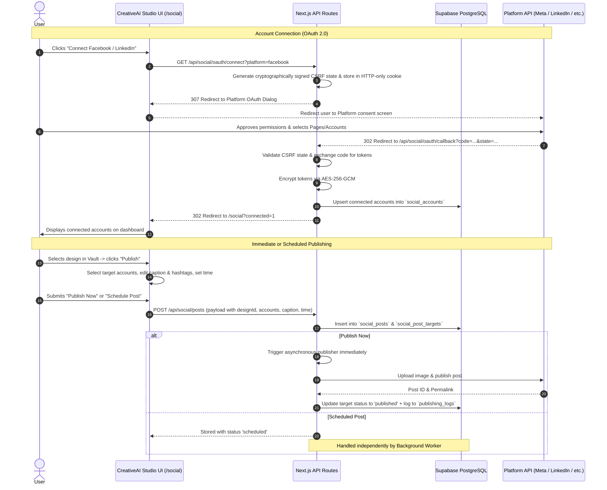

# Universal Social Media OAuth & Auto-Publishing Architecture

This document provides a comprehensive technical overview and integration plan for CreativeAI Studio's Universal Social Media OAuth and Auto-Publishing system.

---

## 1. Supported Platform Matrix & API Capabilities

| Platform | Official API | Auth Flow | Supported Media | Capabilities | Cost / Access Tier |
|---|---|---|---|---|---|
| **Facebook Pages** | Meta Graph API `v19.0+` | OAuth 2.0 (Facebook Login for Business) | Images (JPEG, PNG), Text | Immediate & scheduled Page publishing | **Free** (Standard access for owned pages; App Review for public users) |
| **Instagram Professional** | Instagram Graph API | OAuth 2.0 via Meta Login | Images (1:1, 4:5, 1.91:1), Reels/Video | 2-step container upload & publishing to Business/Creator accounts | **Free** (Requires IG Business/Creator linked to FB Page) |
| **LinkedIn** | LinkedIn UGC Post / Posts API | OAuth 2.0 (OpenID + Member Share) | Images, Text, Articles | Publish to Personal Profile & Organization Pages | **Free** (`w_member_social`, `w_organization_social`) |
| **X (Twitter)** | X API v2 | OAuth 2.0 with PKCE | Images, Text (280 chars) | Status updates with media attachments | **Freemium / Restricted** (Free tier allows write-only up to 1,500 tweets/mo; media upload requires v1.1 endpoint) |
| **YouTube** | YouTube Data API v3 | Google OAuth 2.0 | Video / Shorts, Thumbnails | Video & Shorts publishing, titles, descriptions | **Free** (10,000 quota units/day default limit) |
| **TikTok** | TikTok Content Posting API | OAuth 2.0 (TikTok for Developers) | Video, Photos | Direct post to creator account or draft creation | **Approval Required** (Requires developer application and Content Posting API approval) |

---

## 2. End-to-End User Experience & Flow

---

## 3. Background Scheduling & Reliability Architecture

Because serverless platforms (like Vercel) terminate execution after request completion, scheduled posts must be executed by a decoupled, reliable scheduler that works even when the user closes their browser:

1. **Database-Backed Persistent Queue**:
   - `social_posts` table tracks every post with fields: `scheduled_at`, `status`, `retry_count`, `max_retries`, and `idempotency_key`.
   - `social_post_targets` tracks each destination individually (allowing one post to succeed on Facebook while retrying on LinkedIn).
2. **Execution Worker (`src/services/socialScheduler.ts`)**:
   - Uses **optimistic locking**: selects posts where `scheduled_at <= now()` and updates status to `'publishing'`.
   - **Crash Recovery**: Automatically rescues posts stranded in `'publishing'` for $> 5$ minutes.
   - **Exponential Backoff**: If an API call fails with a transient error, the next attempt is scheduled at:
     $$\text{Next Attempt} = \text{now}() + (2^{\text{retry}} \times 2\text{ minutes})$$
   - Once `retry_count >= max_retries`, the post is marked `'failed'` with specific error details saved.
3. **Automated Trigger Mechanisms**:
   - **Supabase Edge Function** (`supabase/functions/publish-scheduler/index.ts`): calls `/api/social/scheduler` with a bearer secret on a recurring cron (`*/2 * * * *`).
   - **External Cron**: Compatible with Vercel Cron, Cron-Job.org, or Cloudflare Workers.

---

## 4. Security & Access Control

- **Token Encryption at Rest**: All access and refresh tokens are encrypted using **AES-256-GCM** with authenticated 16-byte tags (`src/lib/tokenCrypto.ts`). Decryption keys never reach client-side bundles.
- **CSRF Protection**: OAuth initiation injects a random 16-byte nonce hashed with the authenticated user profile into the `state` parameter and validates it against an HTTP-only, secure, SameSite=Lax cookie upon callback.
- **Strict Row Level Security (RLS)**: Enforced across all social tables (`social_accounts`, `social_posts`, `social_post_targets`, `publishing_logs`). Users can only query or mutate rows mapped to their own `profile_id`.
- **Zero Credit Cost**: Social media scheduling and publishing does not deduct AI image-generation credits.
